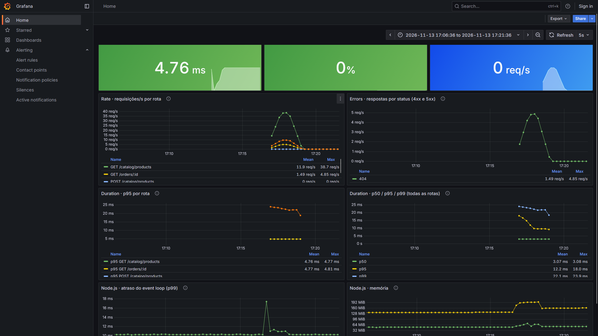
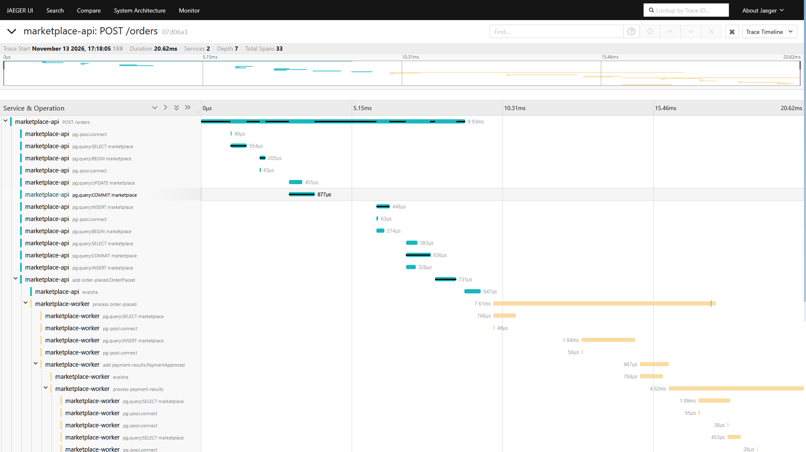
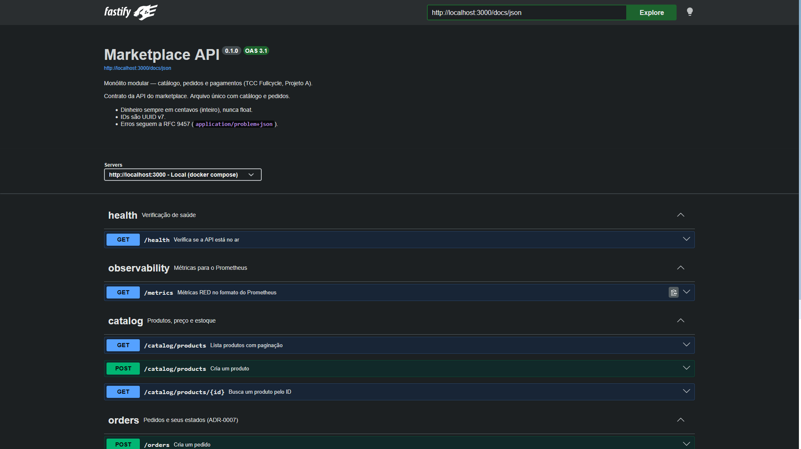
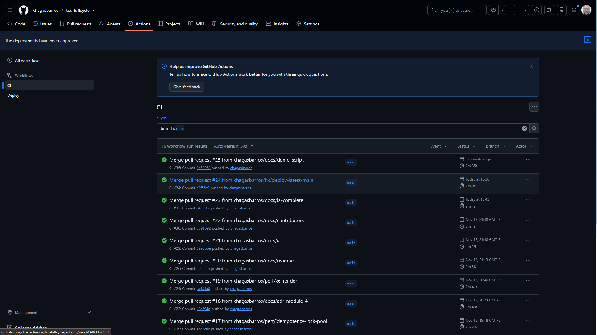
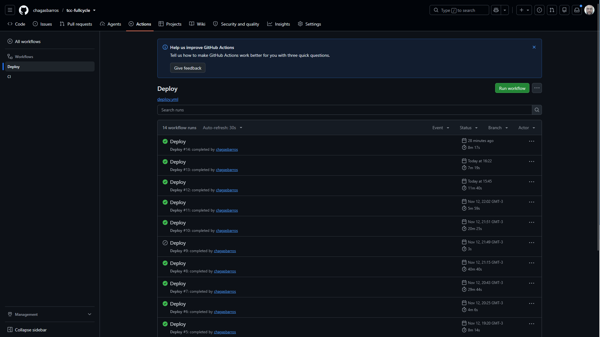

# Apresentação — material de apoio (16/11/2026)

Roteiro de 10 minutos (`CLAUDE.md`, seção 11). Este arquivo é atualizado ao longo do projeto com números medidos e prints. **Só entram aqui números que foram medidos de verdade**, com data e forma de reproduzir.

| Bloco            | Tempo | Conteúdo                                                                                |
| ---------------- | ----- | --------------------------------------------------------------------------------------- |
| Problema e nível | 1 min | Marketplace como monólito modular (catálogo, pedidos, pagamento) — Projeto A (Avançado) |
| Demo             | 3 min | Sobe com 1 comando, cria pedido, pagamento assíncrono, recusa e estoque devolvido       |
| Decisão técnica  | 3 min | Uma decisão e a alternativa descartada                                                  |
| Números          | 3 min | Concorrência, seed, k6 antes/depois e o que faria diferente                             |

## 1. Problema e nível

- Marketplace com três áreas de negócio: **catálogo** (produtos, preço, estoque), **pedidos** (estados e cancelamento) e **pagamentos** (cobrança via gateways).
- Nível: **Projeto A (Avançado)**. Monólito modular, arquitetura documentada (ADRs + C4) e k6 em 3 estágios.
- Fronteiras entre módulos **garantidas por lint**, não por convenção (ADR-0002).

## 2. Roteiro da demo

1. `docker compose up -d` → mostrar api, worker, postgres e redis saudáveis (`docker compose ps`). Use o comando sem `--wait`: com ele, o Compose acusa erro porque o `unleash-setup` termina depois de criar a flag. Num clone limpo, os 11 serviços ficaram estáveis em 39 s (13/11).
2. `POST /catalog/products` → criar um produto de **R$ 100,00** e outro de **R$ 10,13**.
3. `POST /orders` com `paymentMethod: CARD` no produto de R$ 100,00 → `PENDING_PAYMENT`; em seguida `GET /orders/{id}` → `PAID` (pagamento processado pelo worker via fila).
4. `POST /orders` com cartão no produto de **R$ 10,13** → `PAYMENT_FAILED` (o provider fake recusa valores terminados em 13 centavos, ADR-0011) e **o estoque volta**. Atenção: se o produto foi consultado antes, o `GET` pode mostrar o estoque antigo por até 60 s (cache do catálogo, ADR-0014). Para mostrar o estoque na hora, consulte o produto **só depois** do pedido, ou explique a tolerância declarada.
5. Mesmo produto com `paymentMethod: PIX` → `PAID` (Strategy: o provider é escolhido em tempo de execução).
6. **Cancelamento com o worker parado.** Com o worker no ar, o pagamento acontece em milissegundos e o cancelamento chega tarde (`409`). Por isso:
   - `docker compose stop worker` → `POST /orders` → o pedido fica em `PENDING_PAYMENT` (a API continua aceitando pedidos sem o worker, ADR-0010);
   - `POST /orders/{id}/cancel` duas vezes → `200` e depois `409` (estado final, ADR-0007);
   - `docker compose start worker` → os pedidos que estavam na fila são processados.
   - **Atenção:** ao religar o worker, o pedido cancelado **também é cobrado**. O `OrderPlaced` já estava na fila, e o estorno ficou fora do escopo (limitação registrada no ADR-0007). Use isso como gancho para "o que faria diferente", ou religue o worker só no fim da demo.
   - Testado em 13/11 num clone limpo: `200` e `409`; ao religar, o pedido da fila virou `PAID` e o cancelado continuou `CANCELLED`, mas com o pagamento aprovado.
7. Swagger UI em `http://localhost:3000/docs` (e o mesmo em produção: <https://marketplace-api-production.onrender.com/docs>).
8. **Jaeger** (`http://localhost:16686`, serviço `marketplace-api`): abrir o trace do `POST /orders` do passo 3 e mostrar a API e o worker num único trace, com os SQLs da reserva de estoque.
9. **Grafana** (`http://localhost:3001`, abre direto no dashboard "Marketplace — RED"): rate, erros (os `409` do passo 6 aparecem como 4xx) e p95 por rota com a linha de 200 ms do SLO.
10. Copiar o `traceId` de uma linha de log da API (`docker compose logs api`) e achar o mesmo `traceId` nos logs do worker.

## 3. Decisões candidatas para os 3 minutos

| Decisão                                            | Alternativa descartada                        | Por que é boa para apresentar                                    |
| -------------------------------------------------- | --------------------------------------------- | ---------------------------------------------------------------- |
| Reserva atômica de estoque (ADR-0009)              | Só validar o estoque (check-then-act)         | Tem número medido: corrida de 50 pedidos contra estoque 10       |
| Monólito modular com fronteiras no lint (ADR-0002) | Microserviços                                 | Mostra o lint barrando um import indevido                        |
| Um schema do PostgreSQL por módulo (ADR-0005)      | Tudo no `public` com prefixo                  | Fronteira visível no próprio banco (`\dn`)                       |
| Worker em processo separado (ADR-0010)             | Consumers dentro da API                       | Ligado ao p95 medido no k6                                       |
| Trace automático com OpenTelemetry (ADR-0013)      | Spans manuais                                 | 1 pedido = 34 spans em 2 processos, mostrado ao vivo no Jaeger   |
| Idempotency-Key com trava por chave (ADR-0016)     | Chave no Redis com TTL / aceitar 409 enganoso | Teste achou bug real: 9 de 10 duplicatas recebiam `Out of Stock` |
| Staging e produção na mesma instância (ADR-0018)   | Uma instância por ambiente / outro provedor   | Trade-off explícito: dados isolados, recursos compartilhados     |

## 4. Números medidos

### Concorrência e consistência

| Data  | Cenário                                                                                                  | Resultado                                                                                  | Como reproduzir                                   |
| ----- | -------------------------------------------------------------------------------------------------------- | ------------------------------------------------------------------------------------------ | ------------------------------------------------- |
| 08/11 | **50 reservas simultâneas** de 1 unidade contra estoque **10** (`PrismaProductRepository` no PostgreSQL) | **10 aceitas, 40 recusadas**, estoque final **0** (nunca negativo)                         | Script com `Promise.all` de 50 `reserveStock`     |
| 08/11 | Reserva de 2 itens em que o 2º não tem estoque                                                           | 1º item volta ao valor original (**rollback** da transação)                                | Mesmo script, item A com estoque 5 e B com 1      |
| 08/11 | **20 cancelamentos simultâneos** do mesmo pedido via HTTP (`POST /orders/{id}/cancel`)                   | **1 × 200 e 19 × 409**; estoque devolvido **uma única vez**                                | 20 `curl` em paralelo contra a API no Docker      |
| 08/11 | Reentrega do mesmo `OrderPlaced` com outro `jobId` (simula crash do worker)                              | Consumer respondeu `duplicate`; **1 pagamento** no banco; estoque não devolvido duas vezes | Job adicionado manualmente na fila `order-placed` |
| 08/11 | Mesmo `OrderPlaced` com o mesmo `jobId`                                                                  | BullMQ **não criou** job novo                                                              | Idem                                              |

### Seed de dados (`npm run db:seed`)

| Data  | Volume                                                                                     | Tempo                     | Observações                                                |
| ----- | ------------------------------------------------------------------------------------------ | ------------------------- | ---------------------------------------------------------- |
| 08/11 | 5.000 produtos · 19.856 clientes · **100.000 pedidos** · 299.711 itens · 94.924 pagamentos | **~60 s** (meta: < 3 min) | Lotes de 5.000 com `createMany`; Docker Desktop no Windows |

- **Reprodutível:** duas execuções geraram o mesmo hash MD5 de pedidos e de produtos (faker com seed fixa e UUID v7 determinísticos).
- **Consistente:** 0 divergências entre total do pedido e soma dos itens, entre status e pagamento, e na regra de recusa (cartão terminado em 13 centavos).
- Distribuição: 94.325 `PAID` · 5.066 `CANCELLED` · 599 `PAYMENT_FAILED` · 10 `PENDING_PAYMENT`.

### Testes

| Data  | Testes                                                                                   | Observação                                                                                   |
| ----- | ---------------------------------------------------------------------------------------- | -------------------------------------------------------------------------------------------- |
| 08/11 | 109 testes unitários e de rotas                                                          | Coverage de `domain/` e `application/` acima do mínimo de 80%                                |
| 09/11 | 112 testes unitários e de rotas                                                          | Inclui regressão do bug encontrado pelo Pact (abaixo)                                        |
| 09/11 | **15 testes de integração** (Testcontainers: PostgreSQL 16 + Redis 7 reais) em **~18 s** | Repositórios Prisma, concorrência, CHECKs, fluxo completo pedido → fila → pagamento → pedido |
| 09/11 | **7 interações** de contrato Pact (consumidor `storefront` → provedor `marketplace-api`) | Verificação do provedor contra a API HTTP real                                               |

**Bug real encontrado pelo teste de contrato (09/11):** `POST /orders/{id}/cancel` respondia **415 Unsupported Media Type** quando o cliente mandava um corpo vazio em _chunked_ sem `Content-Type` (o verificador do Pact faz isso, e alguns clientes HTTP também). Unit tests com `inject` não pegavam, porque não reproduzem esse formato de requisição. Correção: a rota, que não usa corpo, passou a ignorá-lo; um teste de regressão falha sem a correção e passa com ela. Bom exemplo para a apresentação de **por que testar o contrato e não só a lógica**.

### Observabilidade e CI

| Data  | O quê                                                                                | Resultado                                                                                                                    |
| ----- | ------------------------------------------------------------------------------------ | ---------------------------------------------------------------------------------------------------------------------------- |
| 09/11 | Primeira execução do CI (4 jobs em paralelo)                                         | **Verde na 1ª execução**, ~3 min no total (o job mais lento é o de segurança, 2m43s)                                         |
| 09/11 | Trivy na imagem de runtime                                                           | **10 CVEs HIGH**, todas no npm embutido na `node:22-alpine`; corrigido removendo o npm da imagem final → **0 HIGH/CRITICAL** |
| 09/11 | gitleaks no histórico                                                                | **0 segredos** em 22 commits                                                                                                 |
| 09/11 | Trace de **1 pedido** (`POST /orders` → `order-placed` → worker → `payment-results`) | **34 spans, 2 serviços, 1 único trace**; o mesmo `traceId` nos logs da API e do worker                                       |
| 09/11 | p95 de `GET /catalog/products` no Prometheus (poucas requisições, sem carga)         | **4,9 ms**, contra a meta de 200 ms do SLO (`docs/slo.md`); número real virá do k6                                           |

### Idempotência do pedido (09/11)

| Cenário (PostgreSQL real)                                  | Antes da trava                        | Depois da trava                                                                   |
| ---------------------------------------------------------- | ------------------------------------- | --------------------------------------------------------------------------------- |
| 10 `POST /orders` simultâneos, mesma chave, estoque para 1 | 1 × `201`, **9 × `409 Out of Stock`** | 1 × `201`, 9 × `409 in progress` (+ `Retry-After`); nova tentativa = mesmo pedido |
| Idem, estoque sobrando                                     | —                                     | 1 pedido, estoque reservado 1 vez, 1 evento                                       |

### Deploy no Render (12/11)

| Ambiente   | URL                                                 | Como publica                                          |
| ---------- | --------------------------------------------------- | ----------------------------------------------------- |
| staging    | <https://marketplace-api-staging-7327.onrender.com> | Automático depois do CI verde na `main`               |
| production | <https://marketplace-api-production.onrender.com>   | Depois do staging, com **aprovação manual** no GitHub |

- **Instância compartilhada:** o plano gratuito permite 1 PostgreSQL e 1 Key Value por conta. Os dois ambientes usam a mesma instância, cada um com o seu banco (`marketplace_staging` / `marketplace_production`) e o seu banco lógico no Redis (`/1` / `/0`). Os dados ficam isolados, mas CPU, memória e conexões são compartilhados, e o vencimento de 30 dias vale para os dois.
- **Primeira execução do workflow de deploy (12/11):** staging e produção verdes em **50 s**, com o _smoke test_ (`GET /catalog/products` → 200) passando nos dois. Os dois já estavam no commit publicado, então a espera pela versão nova só fica comprovada no próximo merge.
- **Tropeço real:** a primeira tentativa falhou com `curl: (3) URL rejected: Malformed input`. O _deploy hook_ colado no `gh secret set` (PowerShell) ficou com um caractere invisível. A falha aconteceu **antes** de chamar o Render, então nenhum ambiente foi afetado. A solução foi colar de novo o valor pela interface do GitHub.

### k6 — antes e depois (12/11)

300 VUs, 3 estágios (1 min subida, 3 min sustentação, 1 min descida), mix 80/15/5. Detalhes em `docs/desempenho.md`.

| Cenário                      | p95 `GET /catalog/products` | p95 `POST /orders` | Erro `POST /orders` | RPS | Evidência                                 |
| ---------------------------- | --------------------------- | ------------------ | ------------------- | --- | ----------------------------------------- |
| Baseline (cache off)         | **3.867 ms**                | 8.133 ms           | **36,9%**           | 168 | `pg_stat_activity`: 10/10 conexões presas |
| Pool separado (cache off)    | **97 ms**                   | 1.506 ms           | 0%                  | 603 | conexões livres nos dois pools            |
| Pool separado + cache ligado | **8,3 ms**                  | 64 ms              | 0%                  | 787 | API perto do teto teórico do cenário      |

**História para a apresentação:** o gargalo **não era consulta lenta**, e por isso o `EXPLAIN ANALYZE` não ajudava. Era um impasse no pool de conexões, causado por uma decisão anterior (a trava de idempotência do ADR-0016, que o próprio ADR já listava como custo). A evidência veio do `pg_stat_activity`, com 10 de 10 conexões em `idle in transaction`. A correção foi pequena, um pool separado (ADR-0019), e a alternativa descartada foi "só aumentar o pool", que adiaria o impasse em vez de eliminá-lo. O teste de integração reproduz o bug com 2 conexões.

**k6 no Render staging (12/11, ADR-0022):** 30 VUs, cache ligado. `GET /catalog/products` com p95 de **5,0 ms dentro da API** e **99,77%** em até 200 ms: o SLO é cumprido no ambiente hospedado. Visto pelo k6, o p95 foi de 306 ms, porque a mediana de 192 ms é a rede Brasil–Virgínia. Bom argumento para a banca sobre **por que o SLO é medido dentro da API**. Também responde à ressalva do módulo 4 sobre testar só na máquina do autor.

## 5. O que faria diferente

Revisado pelo autor em 13/11.

- **k6 num ambiente dedicado e representativo de produção** (módulo 4): o antes e o depois foram medidos no notebook (ADR-0020), e o Render gratuito só permitiu um complemento leve (ADR-0022).
- **Trava de idempotência por linha:** o pool separado (ADR-0019) eliminou o impasse, mas os pedidos com chave ainda fazem fila no pool de travas (p95 de 1,5 s com o cache desligado). Uma trava por `INSERT` não seguraria conexão nenhuma.
- **Transactional Outbox:** hoje salvar o pedido e publicar `OrderPlaced` não são atômicos; se a publicação falhar, o pedido fica em `PENDING_PAYMENT` (ADR-0009).
- **Cancelamento depois da cobrança:** um pedido cancelado enquanto o `OrderPlaced` espera na fila ainda é cobrado (ADR-0007). Faltam um evento `OrderCancelled`, para o `payments` não cobrar, e o estorno, para o caso em que a cobrança já aconteceu (visível no passo 6 da demo).
- **Expiração de reservas:** se o worker nunca responder, o estoque fica reservado indefinidamente.
- **Autenticação:** o `customerId` vem no corpo da requisição (ADR-0008).

## 6. Prints

Capturados em 13/11 com o stack local (`docker compose up -d`) depois de cerca de 4.700 requisições de tráfego misto (catálogo, pedidos pagos e recusados, consultas a pedidos inexistentes).

### Grafana: métricas RED e SLO

- No topo: **p95 de `GET /catalog/products` = 4,76 ms** (meta do SLO: 200 ms), **0% de erros 5xx** e a taxa atual.
- **Rate:** requisições por segundo por rota (pico de cerca de 39 req/s no catálogo).
- **Errors:** respostas 4xx e 5xx por status. Os `404` são as consultas a pedidos inexistentes, de propósito.
- **Duration:** p95 por rota e p50/p95/p99 de todas as rotas.

### Jaeger: trace ponta a ponta de um pedido

- Um `POST /orders` com **33 spans em 2 serviços** (`marketplace-api` e `marketplace-worker`), em 20,62 ms no total.
- Na API: os SQLs da reserva de estoque e da gravação do pedido, depois o `add order-placed.OrderPlaced` na fila.
- No worker: `process order-placed`, a gravação do pagamento, `add payment-results.PaymentApproved` e `process payment-results`, que marca o pedido como pago.
- O contexto do trace atravessa a fila duas vezes (ADR-0013).

### Swagger UI

- O contrato `docs/openapi.yaml` (OpenAPI 3.1) servido em `/docs`, o mesmo arquivo que o Spectral verifica no CI.

### CI verde na `main`

- Todas as execuções na `main` verdes (ADR-0017: o CI roda em todo pull request e de novo depois de cada merge).

### Deploy: staging e produção

- Cada merge com CI verde gera um deploy: staging automático, produção depois da aprovação do autor (ADR-0018).
- A execução cinza (#9) foi descartada da fila pelo GitHub porque havia uma mais nova. Desde 13/11, um deploy antigo é pulado, nunca publicado por cima de uma versão mais nova (`docs/ia.md`, entrada 7).

**Lição de operação (09/11):** o disco C: chegou a 0 GB livres, e o Docker Desktop travou e corrompeu os dados dele (erros de _read-only file system_). Limpar o cache do npm (~8 GB) resolveu. Vale verificar o espaço em disco antes da apresentação.
