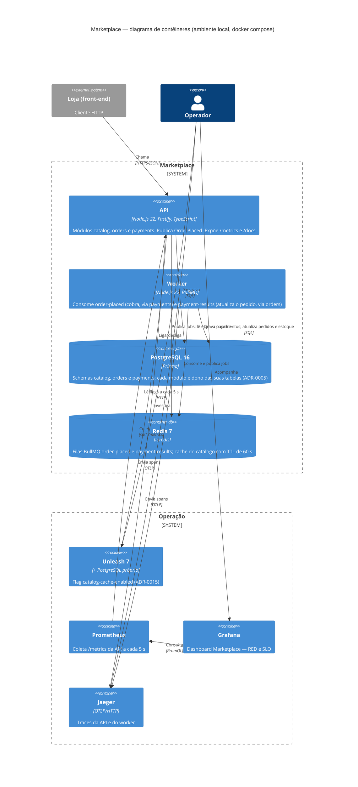
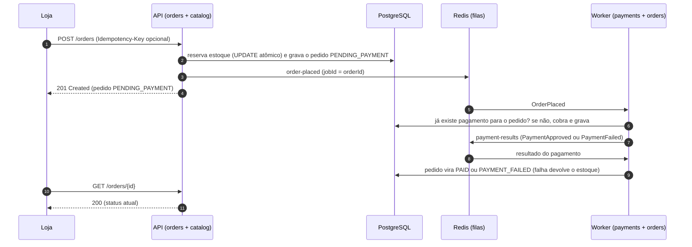

# C4 — Nível 2: Contêineres

> O que roda e como as partes se falam. Visão geral em [`contexto.md`](contexto.md). Tudo abaixo sobe com `docker compose up -d`.

## Contêineres

| Contêiner                         | Porta local         | Responsabilidade                                                                                                                                       | Decisões             |
| --------------------------------- | ------------------- | ------------------------------------------------------------------------------------------------------------------------------------------------------ | -------------------- |
| **API**                           | 3000                | Rotas HTTP dos três módulos, validação com Zod, erros em Problem Details. Reserva estoque e salva o pedido de forma síncrona; a cobrança é assíncrona. | ADR-0001, 0002, 0016 |
| **Worker**                        | —                   | Processo separado com os consumidores das duas filas. Um pagamento lento não ocupa a API.                                                              | ADR-0010, 0011       |
| **PostgreSQL**                    | 5432                | Fonte da verdade. Sem JOIN nem chave estrangeira entre schemas de módulos diferentes.                                                                  | ADR-0005, 0009       |
| **Redis**                         | 6379                | Filas (o `jobId` é o id do pedido, então o mesmo pedido não entra duas vezes) e cache do catálogo, em conexões separadas.                              | ADR-0010, 0014       |
| **Unleash**                       | 4242                | Só no ambiente local. No Render, a flag vem de variável de ambiente.                                                                                   | ADR-0015             |
| **Prometheus / Grafana / Jaeger** | 9090 / 3001 / 16686 | Métricas RED, SLO e trace ponta a ponta.                                                                                                               | ADR-0013             |

Também há dois contêineres de execução única: `migrate` (aplica as migrations antes de a API e o worker subirem) e `unleash-setup` (cria a flag).

## Fluxo de um pedido

O caminho que o trace no Jaeger mostra (34 spans em 2 serviços, medido em 10/11):

## Diferença no Render

No plano gratuito do Render não existe _Background Worker_. Lá, os consumidores rodam **dentro do processo da API**, e não há Unleash, Prometheus, Grafana nem Jaeger. O detalhe está no ADR-0018 (deploy).
