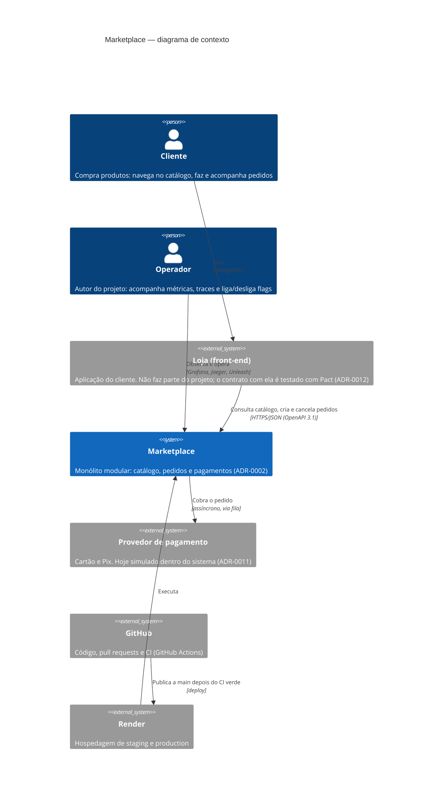

# C4 — Nível 1: Contexto

> Quem usa o Marketplace e com quais sistemas ele conversa. O detalhe interno está em [`conteiner.md`](conteiner.md).

## Elementos

| Elemento                  | Tipo              | Papel                                                                                                                                                     |
| ------------------------- | ----------------- | --------------------------------------------------------------------------------------------------------------------------------------------------------- |
| **Cliente**               | Pessoa            | Identificado só por um `customerId` (UUID) enviado no corpo; não há cadastro nem login no projeto (ADR-0008).                                             |
| **Operador**              | Pessoa            | Usa o Grafana (métricas RED e SLO), o Jaeger (traces) e o Unleash (kill switch do cache).                                                                 |
| **Loja (front-end)**      | Sistema externo   | Não foi construída. O consumidor `storefront` do Pact representa as chamadas que ela faria, e a API é verificada contra esse contrato no CI (ADR-0012).   |
| **Marketplace**           | Sistema do autor  | API REST e processamento assíncrono de pagamentos. Contrato em [`docs/openapi.yaml`](../openapi.yaml), Swagger UI em `/docs`.                             |
| **Provedor de pagamento** | Sistema externo   | Num sistema real seria um gateway (adquirente, PSP Pix). Aqui é simulado por `FakeCardProvider` e `FakePixProvider`, trocáveis pela interface (ADR-0011). |
| **GitHub / Render**       | Sistemas externos | O CI roda em todo pull request e no push para a `main` (ADR-0017); o Render publica os ambientes (ADR-0018).                                              |

## Fora do escopo

- Autenticação, cadastro de clientes, frete e nota fiscal.
- Notificações ao cliente (e-mail, push). O cliente acompanha o pedido consultando `GET /orders/{id}`.
